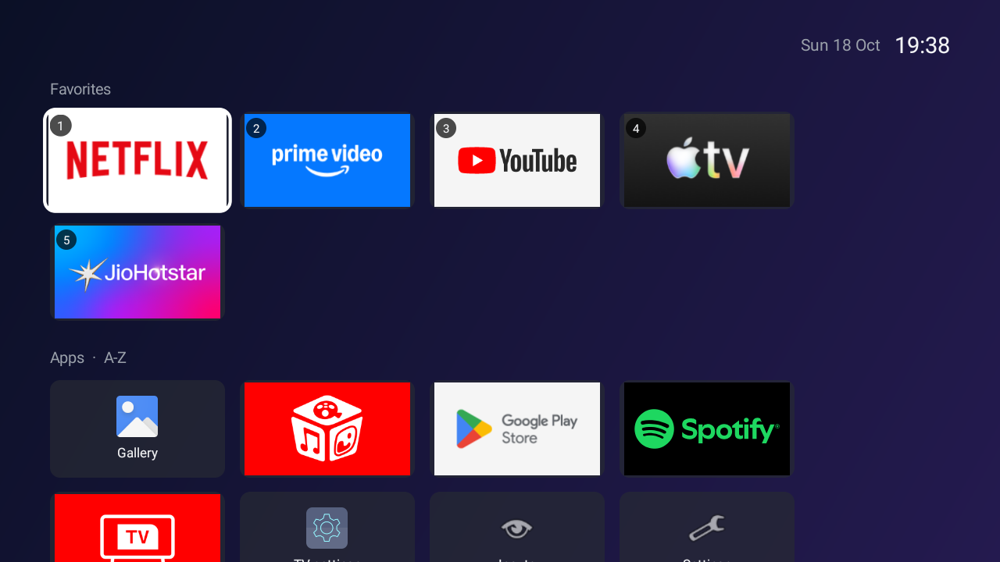

# Zyft Launcher

A tiny, fast, ad-free home screen for Android TV and Google TV.

Stock TV launchers are heavy: recommendation feeds, promoted rows, background services and ads, all running on hardware with 1 to 2 GB of RAM. Zyft Launcher replaces it with a plain grid of the apps you actually use.



- **Small and fast:** about 50 KB, no libraries, opens in roughly 100 ms.
- **No ads, no feeds, no tracking:** the app has **no internet access**. Its only permission is reading network state, to warn you when the TV is offline.
- **Built for the remote:** D-pad navigation, long-press menus, nothing that needs a pointer.
- **Fully reversible:** one command puts your TV back exactly as it was.

## Features

- Number keys 1-9 on the remote open your first nine favorites
- Favorites row (Netflix, Prime Video, YouTube, Apple TV and JioHotstar are pinned by default when installed)
- All apps grid, sorted A-Z, by most used or by recently used
- Vendor setup and service tools (factory menu, OTA, remote service, ...) hidden by default without disabling them; bring them back from Customize
- Pin, hide or unhide apps, or jump to their App info, from a side sheet; reorder favorites by picking one up and sliding it
- Inputs sheet for HDMI / AV, with each port's custom name and signal state
- Six gradient backgrounds, previewed live on the real home screen before you apply (no wallpaper images, so no memory cost)
- Clock and date, plus an amber "No network" / "Wi-Fi needs sign-in" chip
- A focus ring readable on any app banner (lime ring with a dark gap), row-by-row scrolling with a sticky header
- Optional debloat: disables the stock launcher's recommendation services and vendor bloat, per TV brand

See [ROADMAP.md](ROADMAP.md) for what's coming next.

## Compatibility

| Device | Status |
| --- | --- |
| TCL 32ES568 (Android TV 9) | Tested, daily use |
| Google TV emulator (Android 12) | Tested |
| Other Android TV / Google TV, Android 7.0+ | Should work; please report |
| Amazon Fire TV | Not supported: Fire OS doesn't allow replacing the home screen without root |
| Roku, webOS, Tizen, VIDAA | Not Android, not supported |

If you try it on another TV, please open an issue with the output of `make scan` so we can add a profile for your brand.

## Install

You need a computer with [`adb`](https://developer.android.com/tools/releases/platform-tools) on the same network as the TV. The helper scripts are bash (macOS, Linux, or WSL / Git Bash on Windows).

### 1. Enable developer mode on the TV

1. **Settings > System > About** (or **Settings > Device Preferences > About**), then click **Build** 7 times.
2. **Settings > System > Developer options**, turn on **USB debugging**. On Android TV this also allows network debugging on port 5555.
3. Note the TV's IP address from **Settings > Network & Internet**.

### 2. Get the APK

Download the latest `zyft-launcher-*.apk` from [Releases](../../releases), **or** build it yourself (see [Development](#development)).

<details>
<summary>Verify the download (optional)</summary>

Every release is signed with the same key. Check it with `apksigner` from the Android build tools:

```sh
apksigner verify --print-certs zyft-launcher-1.0.0.apk | grep SHA-256
# Signer #1 certificate SHA-256 digest: 66a521d615754c29f4dbee76c0c770a6aa4b37bc740236e5bd8503307d550eea
```

If the digest differs, don't install it. A build you made yourself is signed with your own debug key, so it can't upgrade a release install (uninstall first).

</details>

### 3. Install and make it the home screen

```sh
git clone https://github.com/rishikesh-suvarna/zyft-launcher.git && cd zyft-launcher
make install TV=192.168.1.50 APK=~/Downloads/zyft-launcher-1.0.0.apk
```

The first time, the TV shows **"Allow USB debugging?"**. Tick *Always allow* and press OK. The script installs the app, asks before disabling the stock launcher, and opens the new home screen. Press **Home** on the remote to check.

<details>
<summary>Doing it by hand, without the scripts</summary>

```sh
adb connect 192.168.1.50:5555
adb install -r zyft-launcher.apk
# Find the stock home app(s):
adb shell cmd package query-activities --brief -a android.intent.action.MAIN -c android.intent.category.HOME
# Disable it, e.g. Android TV / Google TV:
adb shell pm disable-user --user 0 com.google.android.tvlauncher
adb shell pm disable-user --user 0 com.google.android.apps.tv.launcherx
# Undo later with: adb shell pm enable <package>
```

Android TV has no "choose default home app" screen, which is why the stock launcher has to be disabled rather than just switched away from.

</details>

### 4. Optional: remove bloat

```sh
make scan TV=192.168.1.50      # read-only: shows device info, home apps, vendor packages, RAM use
make debloat TV=192.168.1.50   # disables the packages in your brand's profile, after asking
```

Debloat uses [`profiles/android-tv.txt`](profiles/android-tv.txt) plus `profiles/<brand>.txt` when one exists for your TV (detected automatically). Packages are **disabled, never uninstalled**, and every change is logged.

### Back up and restore settings

```sh
make backup TV=192.168.1.50                                   # saves backups/<tv-ip>-<timestamp>.zyft
make restore-backup TV=192.168.1.51 FILE=backups/....zyft     # e.g. onto a new TV, after make install
```

Covers favorites and their order, hidden apps, sort, background and usage counts. The file is plain text (one `type<TAB>key<TAB>value` line per setting), so you can edit it before restoring; a file with any bad line is rejected as a whole. Only the adb shell can read or write settings: the launcher's bridge requires the `DUMP` permission, which apps can't get.

### Undo everything

```sh
make restore TV=192.168.1.50
```

Re-enables exactly what `install` and `debloat` disabled, resets animation speed, and offers to uninstall Zyft Launcher. The log lives in `.tv-state/<tv-ip>.disabled`, so run restore from the same machine and keep the TV on the same IP (or rename the file).

## Using it

| Remote | Action |
| --- | --- |
| D-pad + OK | Move and open |
| 1 - 9 | Open favorite 1 - 9 (shown as a badge on each tile) |
| Long-press OK, or Menu | App options: favorite, move, hide / unhide, app info |
| In move mode | Left / right moves the tile, OK keeps the new spot, Back cancels |
| Home or Back | Back to the top of the launcher |
| In a sheet | Back (or Left) closes it |
| **Customize** tile | Sort order, background (live preview, OK applies, Back reverts), show hidden apps |
| **Inputs** tile | Switch to HDMI / AV |

## Troubleshooting

- **Home still opens the old launcher:** some brands ship a second home app. Run `make scan`, look under "Home apps", and disable the extra one (or open an issue).
- **Can't connect:** TV and computer must be on the same network, and USB debugging must be on. Some TVs only allow adb over a USB cable or via *Wireless debugging* pairing.
- **A system update brought the old launcher back:** updates can re-enable packages. Run `make install` again.
- **Something broke after debloat:** `make restore` re-enables everything. Then please open an issue so we can fix the profile.

## Development

Requirements: JDK 17 and the Android SDK (platform 36). No Android Studio needed.

```sh
make build                  # release APK in app/build/outputs/apk/release/
make test                   # unit tests
make check                  # everything CI runs: shellcheck, tests, lint, build
make ci-local               # run the real GitHub Actions job in Docker via act (slow on Apple Silicon)
make emulator               # boot an Android TV AVD named "tcl_tv"
make fonts SRC=... LICENSE=...  # rebuild the Google Sans subsets + banner wordmark (needs fonttools)
make install TV=emulator-5554
make backup TV=192.168.1.50  # launcher settings to a file; make restore-backup puts them back
```

```
app/src/main/java/.../
  MainActivity.kt      Home screen UI, focus handling, dialogs
  AppRepository.kt     Finds launchable apps (TV banners preferred)
  AppArranger.kt       Pure favorites / hidden / ordering logic
  Sorting.kt           Sort modes
  LauncherPrefs.kt     Favorites, hidden apps, usage counts, settings
  Backdrop.kt          Gradient backgrounds
profiles/              Debloat lists: generic Android TV + one per brand
scripts/               adb tooling behind the make targets
```

To drive the emulator from your keyboard (arrows = D-pad, Enter = OK, Esc = Back), set `hw.keyboard = yes` in `~/.android/avd/<name>.avd/config.ini`.

Design rules: no dependencies beyond the Kotlin stdlib, no internet permission, no new permissions without a strong reason, keep the logic in pure functions with JVM unit tests, and measure cold start before adding anything heavy.

Releases: pushing a `v*` tag builds a signed APK and publishes it to GitHub Releases. Set the secrets `RELEASE_KEYSTORE_BASE64`, `RELEASE_STORE_PASSWORD`, `RELEASE_KEY_ALIAS` and `RELEASE_KEY_PASSWORD` first; the workflow refuses to publish debug-signed builds.

The release key must never change: Android only installs an update signed with the same key as the installed app. GitHub secrets can't be read back, so keep an offline backup of the keystore file and its password. If you fork this project, generate your own key (PKCS12, RSA 4096, 25+ years validity) and publish its fingerprint here.

## Contributing

Brand profiles are the most useful contribution. See [CONTRIBUTING.md](CONTRIBUTING.md).

## License

[MIT](LICENSE). The bundled Google Sans font is licensed separately under the
[SIL Open Font License 1.1](app/src/main/assets/fonts/GoogleSans-OFL.txt); "Google Sans" is a
trademark of Google LLC, and this project is not affiliated with or endorsed by Google.
